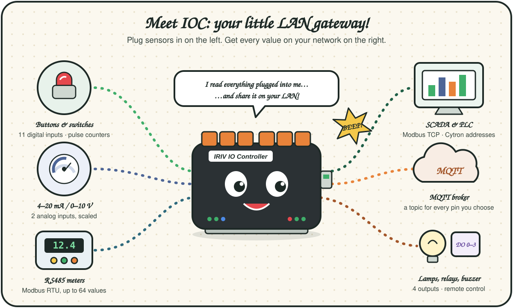
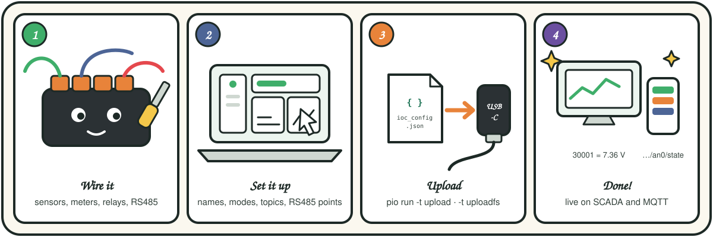
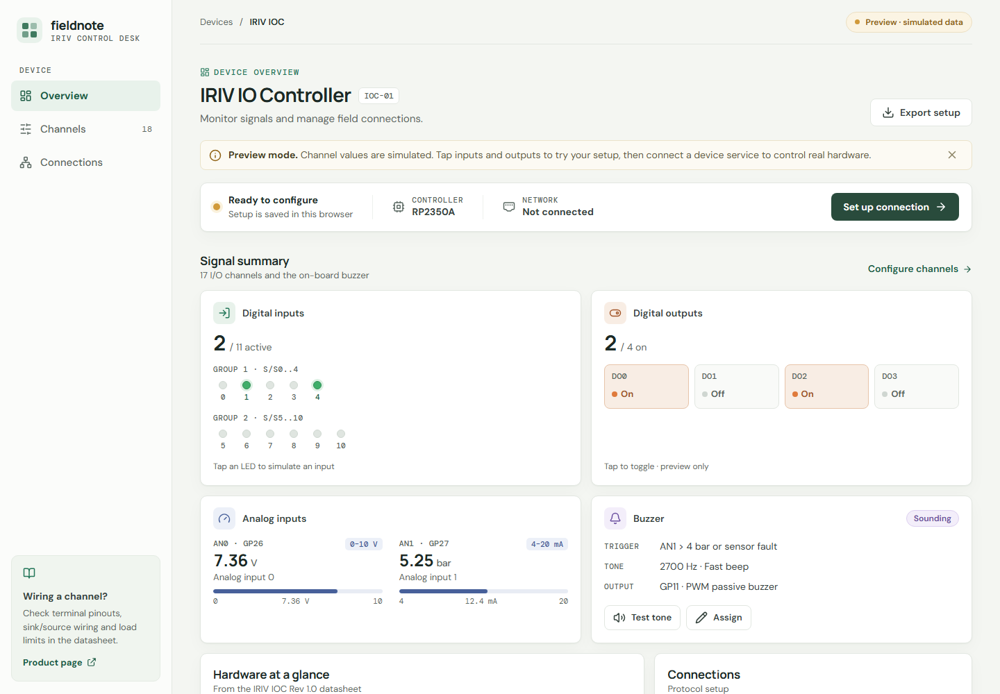
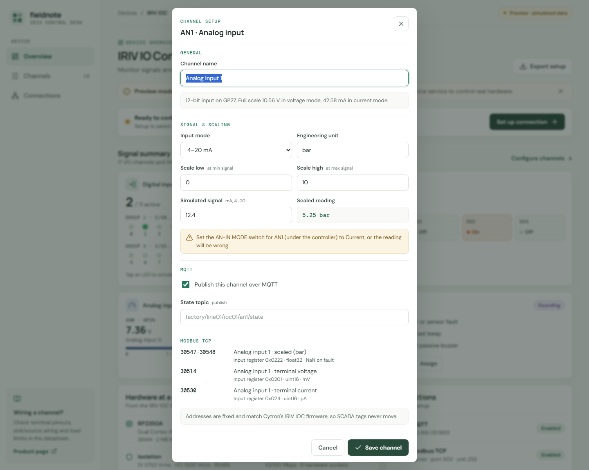
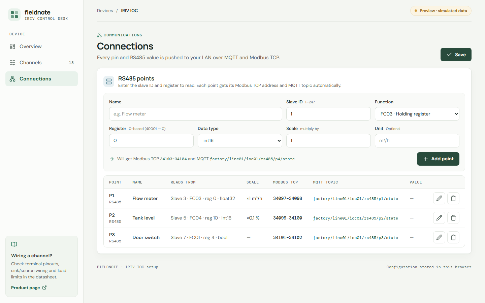
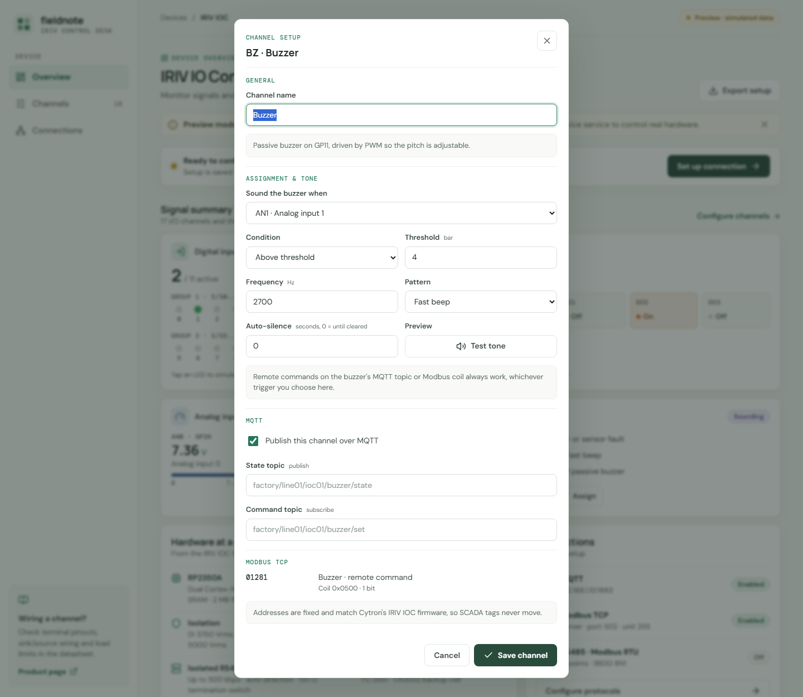
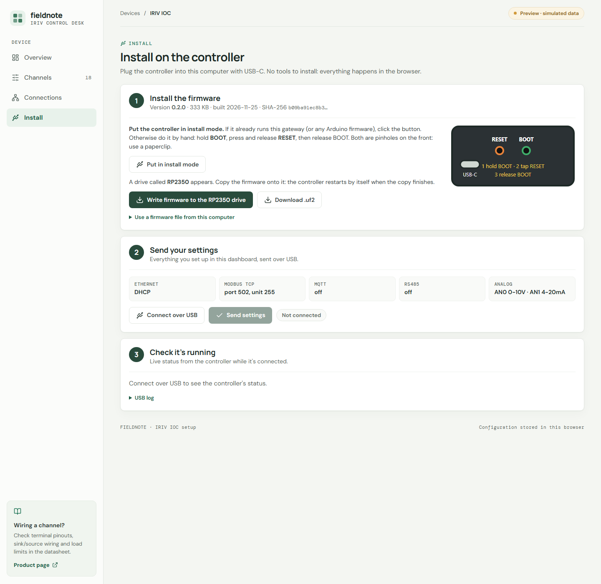
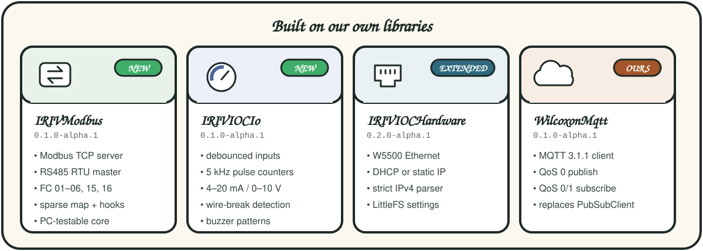
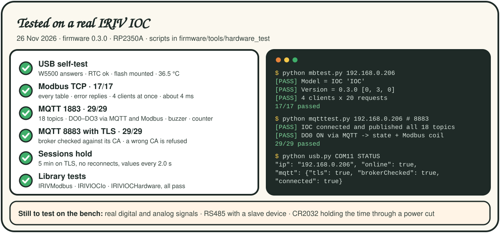

<p align="center"></p>

<h1 align="center">IRIV IOC Gateway</h1>

<p align="center"><b>Turn a Cytron IRIV IO Controller into a LAN gateway in an afternoon.</b><br>
Every input, output and RS485 device value, on <b>Modbus TCP</b> and <b>MQTT</b> at the same time.<br>
Set it up in a friendly browser dashboard, install from the same page, done.</p>

<p align="center">
  <a href="https://dineshpalsingh1989.github.io/IRIV-IOC-Gateway/"><b>▶ Try the dashboard live</b></a>
  &nbsp;·&nbsp;
  <a href="https://dineshpalsingh1989.github.io/IRIV-IOC-Gateway/#install"><b>⚡ Install from your browser</b></a>
  &nbsp;·&nbsp;
  <a href="https://github.com/dineshpalsingh1989/IRIV-IOC-Gateway/releases/latest"><b>⬇ Download firmware</b></a>
</p>

<p align="center"><a href="https://github.com/dineshpalsingh1989/IRIV-IOC-Gateway/actions/workflows/build.yml"></a></p>

<p align="center">
  <a href="#-what-can-it-do">What it does</a> ·
  <a href="#-how-it-works">How it works</a> ·
  <a href="#-quick-start-install-from-your-browser">Quick start</a> ·
  <a href="#-our-own-libraries">Libraries</a> ·
  <a href="#-customize-it">Customize</a>
</p>

---

## 🎯 What can it do?

| | You plug in… | IOC gives you… |
| :---: | --- | --- |
| 🔘 | **Buttons, switches, proximity sensors** on DI0–DI10 | On/off states, debounced. DI1/3/5/7/9 can **count pulses** up to 5 kHz (flow and energy meters). |
| 🌡️ | **4–20 mA or 0–10 V transmitters** on AN0/AN1 | Values in **your units** (bar, °C, %…), plus **wire-break alarms** when a 4–20 mA loop drops below 3.6 mA. |
| 📟 | **RS485 Modbus RTU devices** (meters, drives, sensors) | Type the slave ID and register once: the value gets its **own Modbus TCP address and MQTT topic automatically**. Up to 64 values. |
| 💡 | **Lamps, relays, contactors** on DO0–DO3 | Switch them from **SCADA** (Modbus coils) or **MQTT** (`ON`/`OFF`). |
| 🔔 | The **built-in buzzer** | Beeps on a remote command, while an input is active, or when an analog value crosses a limit. Pick the pitch and pattern. |
| 🖥️ | Your **SCADA / PLC** | Modbus TCP with the **same addresses as Cytron's own firmware**, so existing tags keep working. |
| ☁️ | Your **MQTT broker** | A topic for every pin you choose; states on change, measurements on an interval. |

> Holding the **USER** button while powering up starts the controller on `192.168.4.1`, so you can always find it with a laptop.

## 🧩 How it works

<p align="center"></p>

1. **Wire it.** Sensors, meters and relays to the terminals; RS485 devices to A/B/G.
2. **Set it up.** Open the [dashboard](https://dineshpalsingh1989.github.io/IRIV-IOC-Gateway/). Name your signals, choose analog modes and scaling, assign the buzzer, add RS485 points, set Ethernet, MQTT and Modbus. Try everything with simulated values first. Settings stay in your browser.
3. **Install.** Plug the controller in with USB-C and open the **Install** page: one click puts the firmware on, one click sends your settings.
4. **Done!** SCADA reads Modbus TCP, MQTT clients subscribe to your topics.

## 📸 The dashboard

| | |
| --- | --- |
|  **Overview.** Tap LEDs and outputs to simulate. |  **Analog setup.** Pick the mode, scale it, and get reminded of the DIP switch. |
|  **RS485 points.** The TCP address and topic are assigned for you. |  **Buzzer.** Assign a trigger and hear it with **Test tone**. |

## 🚀 Quick start: install from your browser

No tools to install. You need **Chrome or Edge on a computer** and a USB-C cable.

<p align="center"></p>

1. Open the **[web installer](https://dineshpalsingh1989.github.io/IRIV-IOC-Gateway/#install)** (set up your channels and connections first, on the other pages).
2. **Install the firmware.** Click **Put in install mode** (or hold BOOT, tap RESET, release BOOT with a paperclip). If the gateway is already on the controller, it runs the hardware self-test first and asks before going on if anything fails. A drive called **RP2350** appears: click **Write firmware to the RP2350 drive** and pick it. The latest firmware comes with the page, so there is no file to download. The controller restarts, the installer reconnects by itself and the USB log shows the result:

   ```
   ==== IRIV-IOC_886257 · IRIV IOC Gateway 0.3.0 is running ====
   IP address : 192.168.0.206 (DHCP)
   Modbus TCP : port 502
   MQTT       : connected to 192.168.0.138 (TLS, broker checked)
   Self-test  : no problems found
   ```
3. **Send your settings.** Click **Connect over USB**, pick the controller, then **Send settings**. It saves them, restarts and reconnects.
4. **Check it's running.** Step 3 shows the IP address, MQTT, Modbus TCP clients and every RS485 value, live.

🔍 **It checks the device first.** The installer reads the USB IDs, the chip named on the install drive and the chip inside the firmware file, and only writes firmware built for that processor (the IRIV IOC's RP2350A). An ESP32 or RP2040 board, or the wrong .uf2, is refused before anything is written.

Other browsers can still use **Download .uf2** and drag the file onto the RP2350 drive. Firmware files are also on the [releases page](https://github.com/dineshpalsingh1989/IRIV-IOC-Gateway/releases/latest).

<details>
<summary><b>For developers: build with PlatformIO</b></summary>

```sh
git clone https://github.com/dineshpalsingh1989/IRIV-IOC-Gateway.git
cd IRIV-IOC-Gateway/firmware
# optional: put an exported ioc_config.json in data/ to flash settings too
pio run -t upload       # firmware
pio run -t uploadfs     # settings from data/
pio device monitor      # watch it start: IP address, MQTT, RS485
```

Every push runs the checks, builds the firmware and republishes the dashboard and installer to GitHub Pages ([workflow](.github/workflows/build.yml)). Tag `v*` to attach the firmware to a release.
</details>

No settings sent yet? The gateway still starts: DHCP, Modbus TCP on port 502, MQTT and RS485 off.

## 🛠️ Our own libraries

<p align="center"></p>

The firmware has **no third-party Modbus or MQTT code**: every protocol and board detail lives in our own MIT libraries in [`firmware/lib/`](firmware/lib/), so we control and fix all of it. The only outside library is ArduinoJson, used to read the settings file.

| Library | What it does |
| --- | --- |
| [IRIVModbus](firmware/lib/IRIVModbus/README.md) | Modbus TCP server (all four tables, FC 01–06/15/16) and RS485 RTU master. The protocol core runs and is tested on a PC. |
| [IRIVIOCIo](firmware/lib/IRIVIOCIo/README.md) | Digital inputs with debounce, pulse counters, outputs, 0–10 V / 0–20 mA / 4–20 mA scaling, NAMUR NE43 faults, buzzer rules. |
| [IRIVIOCHardware](firmware/lib/IRIVIOCHardware/README.md) | W5500 Ethernet with DHCP or static IP, LittleFS settings. |
| [WilcoxonMqtt](firmware/lib/WilcoxonMqtt/README.md) | Small MQTT 3.1.1 client, a drop-in replacement for PubSubClient. |

## 🎨 Customize it

The libraries are small and readable on purpose. Some common changes:

**Serve another value over Modbus TCP**: add a block to the map in `firmware/src/main.cpp` and fill it in `updateIo()`.

```cpp
static uint16_t uptimeRegs[2];
modbusMap.addRegisters(irivmb::Area::InputRegisters, 0x0600, 2, uptimeRegs);   // in buildModbusMap()
irivmb::putU32(uptimeRegs, millis() / 1000, cfg.modbusOrder);                  // in updateIo()
```

**React when SCADA writes a coil or register**: extend the `afterWrite` hook.

```cpp
static void afterModbusWrite(irivmb::Area area, uint16_t address, uint16_t count, void*) {
    if (area == irivmb::Area::Coils && address == 0x0500) { /* buzzer coil written */ }
}
```

**Use the I/O library on its own** in any Arduino-Pico sketch:

```cpp
#include <IRIVIOCIo.h>
IRIVIOCIo io;
void setup() { io.begin(); io.setCounter(1, true); }          // count pulses on DI1
void loop() {
    io.update(millis());
    io.setOutput(0, io.input(3));                              // DO0 follows DI3
    float mA = iriv::analogSignal(iriv::AnalogMode::MilliAmp4To20, io.adc(0), io.adcReference);
}
```

**Tune it**

| Setting | Where | Default |
| --- | --- | --- |
| Modbus TCP client slots | `-D IRIVMODBUS_TCP_CLIENTS=6` in `platformio.ini` | 4 |
| ADC reference (calibration) | `io.adcReference` | 3.32 V |
| Input debounce | `io.debounceMs` | 10 ms |
| TCP idle / frame timeouts | `modbus.idleTimeoutMs`, `modbus.frameTimeoutMs` | 60 s / 5 s |
| RS485 reply timeout, poll interval | Dashboard → Connections → RS485 | 500 ms / 1 s |

If you change Modbus addresses, change them in **both** `firmware/src/register_map.h` and `MB` in `app.js`, then run `python firmware/tools/check_register_map.py`.

## 🗺️ Modbus TCP map at a glance

| Address | What | |
| --- | --- | --- |
| `0x0000`–`0x000A` | DI0–DI10 (discrete inputs) | same as Cytron |
| `0x0100`–`0x0103` | DO0–DO3 (coils) | same as Cytron |
| `0x0200` / `0x0210` | AN0/AN1 in mV / µA | same as Cytron |
| `0x0300` / `0x0310` / `0x0400` | Counter enable / reset / 32-bit counts | same as Cytron (count bug fixed) |
| `0x0220`–`0x0223` | AN0/AN1 scaled, float32 | new |
| `0x0500` | Buzzer (coil) | new |
| `0x1000`+ | RS485 points, float32 | new |

Full table, MQTT payloads and notes: [`firmware/README.md`](firmware/README.md).

## 📁 What's in here

```
index.html, app.js, styles.css   the dashboard (no build step, no dependencies)
install.js                       the web installer (Web Serial + File System Access)
.github/workflows/build.yml      checks, firmware build, GitHub Pages and releases
firmware/                        PlatformIO project for the IRIV IOC (RP2350A)
  src/                           gateway: Ethernet, I/O, Modbus TCP, MQTT, RS485 on core 1
  lib/                           our libraries
  tools/                         register-map check and PC tests
  data/                          put ioc_config.json here (example included)
docs/                            README images and screenshots
```

## 🚧 Status

**Tested on a real IRIV IOC** (26 Nov 2026, firmware 0.3.0): self-test, Modbus TCP, MQTT on 1883 and over TLS on 8883, outputs, buzzer and counters all passed. The scripts are in [firmware/tools/hardware_test](firmware/tools/hardware_test/README.md), so you can run the same checks on your unit; full results in the [session notes](docs/notes/2026-11-26-session.md).

<p align="center"></p>

**Not yet tested on hardware:** real digital and analog signals (readings are uncalibrated), RS485 with a slave device, and the CR2032 holding the time through a power cut. Check those on the bench before connecting equipment. MQTT can run over TLS (port 8883); give the broker's CA certificate so the controller checks who it is talking to.

Check the wiring and load limits against the IRIV IOC datasheet: outputs are 50 V / 500 mA solid-state relays, and the analog mode must match the AN-IN MODE DIP switch.

## 📜 License

MIT, see [LICENSE](LICENSE). Each library in `firmware/lib/` carries its own MIT licence.
