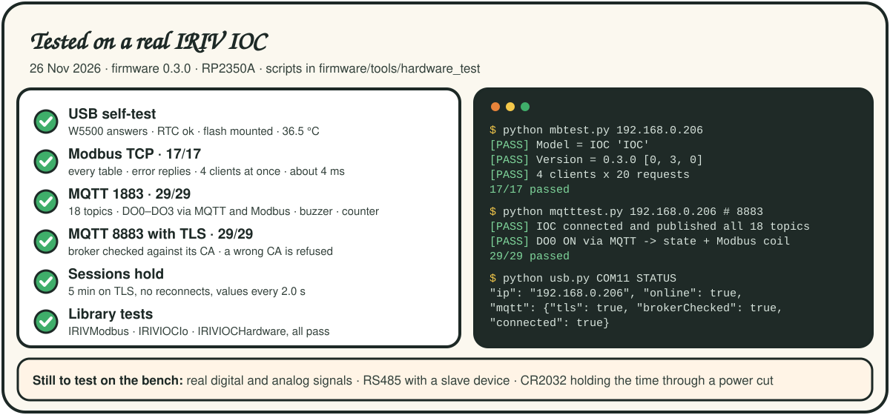

# IRIV IOC Gateway

Turns a **Cytron IRIV IO Controller** (RP2350A) into a LAN gateway: every input, output, analog value and RS485 Modbus RTU sensor on **Modbus TCP** and **MQTT** at the same time, set up from a browser.

- **Web installer and dashboard:** https://dineshpalsingh1989.github.io/IRIV-IOC-Gateway/
- **Source and releases:** https://github.com/dineshpalsingh1989/IRIV-IOC-Gateway (MIT licence, fork it freely)

## Start here

1. **[[Install|Install]]** the firmware: one click in Chrome or Edge over USB-C.
2. Set up channels, MQTT, Modbus and RS485 in the dashboard and **send the settings** over USB.
3. Open the **[[controller's own page|Controller-Web-Page]]** at `http://<its IP>/` for live values, saving over the LAN and updates from GitHub.

## Pages

| Page | What is in it |
| --- | --- |
| [[Install]] | What the Install button does for new, old, up-to-date or foreign firmware |
| [[Controller web page|Controller-Web-Page]] | Live view, web password, Save to controller, Update from GitHub, output test |
| [[MQTT]] | Topics, payloads, port 1883 and 8883 (TLS) with and without a CA certificate |
| [[RS485]] | Bus settings, Test read, adding points, automatic Modbus addresses and topics |
| [[Modbus TCP map|Modbus-TCP-Map]] | Every address SCADA and PLCs can read and write |
| [[Troubleshooting]] | USB not found, lost IP address, MQTT not connecting, wire break |

## What is tested on hardware

Tested on a real IRIV IOC on 26 Nov 2026: self-test, Modbus TCP (17/17), MQTT on 1883 and on 8883 with TLS (29/29, with and without CA; a wrong CA is refused), outputs, buzzer, counters, firmware updates over USB and over the LAN, and the controller's web page (16/16).

Not yet tested on hardware: real digital and analog signals (readings are uncalibrated), RS485 with a real sensor, the CR2032 keeping the time through a power cut. Check those on the bench before connecting equipment.
